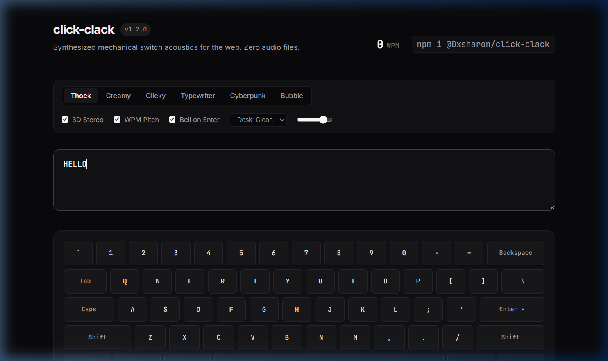

# click-clack ⌨️

> Procedurally synthesized mechanical keyboard acoustics for web apps.  
> **Zero audio files**, under **2KB minified**, powered by the Web Audio API.

[](https://www.npmjs.com/package/@0xsharon/click-clack)
[](https://bundlephobia.com/package/@0xsharon/click-clack)
[](https://github.com/0xSHARON/click-clack)
[](https://github.com/0xSHARON/click-clack/actions)
[](./LICENSE)

---

## 🎧 Interactive Studio

👉 **[Try the Live Demo](https://0xsharon.github.io/click-clack/)** — Plug in headphones to hear the 3D ear-to-ear spatial panning in real-time.

<p align="center">
  <a href="https://0xsharon.github.io/click-clack/">
    
  </a>
</p>

---

## Why this exists

Tactile micro-feedback makes web apps feel alive, responsive, and satisfying. But loading real audio files comes with headaches:

1. **Asset Bloat:** A basic sound pack of switch samples easily adds 300KB–1MB of `.mp3` or `.wav` files to your network payload.
2. **Latency & Jitter:** Decoding audio files introduces perceptible micro-delays between physical keystrokes and playback.
3. **Machine-Gun Monotony:** Playing the exact same audio sample 100 times per minute sounds artificial and robotic.

`click-clack` takes an acoustic physics approach. Instead of playing recorded audio, it uses the browser's native **Web Audio API** to generate the sound waves procedurally on the fly using oscillators, bandpass filters, and shaped pink noise bursts.

- **Weight:** Under 2KB minified.
- **Dependencies:** 0.
- **Audio Assets:** 0.
- **Latency:** Instantaneous (<1ms).

---

## Key Features

- 🪨 **6 Switch Profiles:**
  - `thock` — Lubed tactile/linear mechanical switches (Holy Panda / Topre bottom-out).
  - `creamy` — High-pitch marbly custom keyboard sound with lubed linear glide.
  - `clicky` — Crisp click-leaf with metallic spring resonance (Cherry MX Blue / Kailh Box White).
  - `typewriter` — Vintage steel typewriter with mechanical arm strike.
  - `cyberpunk` — Retro 80s computer terminal key with subtle synth blip.
  - `bubble` — Modern soft UI pop.
- 🎧 **3D Spatial Stereo Panning:** Keys on the left of your physical keyboard (`Q, A, Z`) pan slightly to your left ear; keys on the right (`P, L, Enter`) pan to your right ear.
- 🏎️ **WPM Flow-State Dynamics:** Automatically tracks typing speed. Typing over 60 WPM subtly tightens the acoustic decay and nudges pitch upward for a rewarding flow state.
- 🪵 **Deskmat Acoustic Resonance:** Toggle between `none`, `felt` (high-cut dampening), `wood` (warm body resonance), and `metal` (high ring).
- 🔔 **Typewriter Carriage Return Bell:** Synthesizes an authentic mechanical `"DING!"` bell when pressing `Enter`.
- 📱 **Mobile Haptics:** Synchronizes a subtle 7ms vibration pulse via `navigator.vibrate` on supported touchscreen devices.
- 🧩 **Multi-Framework:** First-class packages for **React**, **Vue 3**, **Svelte**, and **Zero-Code HTML Attributes**.

---

## Installation

```bash
npm install @0xsharon/click-clack
```

Or with your preferred package manager:

```bash
pnpm add @0xsharon/click-clack
# or
yarn add @0xsharon/click-clack
# or
bun add @0xsharon/click-clack
```

---

## Quick Start

### 1. Vanilla JavaScript / TypeScript

Attach to any input, textarea, or the entire window:

```ts
import { attachMechanicalAudio } from '@0xsharon/click-clack';

// Attach to a specific textarea
const detach = attachMechanicalAudio(document.querySelector('textarea'), {
  profile: 'creamy',      // Switch sound profile
  volume: 0.8,           // Master volume (0.0 - 1.0)
  stereoPan: true,       // Enable 3D ear-to-ear spatial positioning
  wpmDynamics: true,     // Ramps pitch when typing fast (>60 WPM)
  deskmat: 'wood',       // 'none' | 'felt' | 'wood' | 'metal'
  carriageBell: true,    // Chime bell on Enter
  playRelease: true      // Play softer upstroke reset click on keyup
});

// Clean up when destroying the element or unmounting
detach();
```

### 2. Manual Triggers

Play sounds imperatively anywhere in your app (buttons, shortcuts, canvas games):

```ts
import { playSwitch } from '@0xsharon/click-clack';

// Trigger switch sound on button click
submitButton.addEventListener('click', () => {
  playSwitch({ profile: 'creamy', volume: 0.9 });
});

// Trigger spacebar stabilizer sound manually
playSwitch({ profile: 'thock', key: ' ' });
```

---

## Framework Integrations

### React (`@0xsharon/click-clack/react`)

```tsx
import React, { useRef } from 'react';
import { useClickClack, useGlobalClickClack } from '@0xsharon/click-clack/react';

export function NoteEditor() {
  const textareaRef = useRef<HTMLTextAreaElement>(null);

  // Automatically binds keydown & keyup listeners to this ref
  useClickClack(textareaRef, {
    profile: 'creamy',
    stereoPan: true,
    wpmDynamics: true
  });

  return (
    <textarea
      ref={textareaRef}
      placeholder="Type to feel the switches..."
    />
  );
}

// Or enable across the entire window:
export function App() {
  useGlobalClickClack({ profile: 'thock', volume: 0.7 });
  return <div id="app">...</div>;
}
```

### Vue 3 (`@0xsharon/click-clack/vue`)

Use the `v-click-clack` directive:

```vue
<script setup>
import { vClickClack } from '@0xsharon/click-clack/vue';
</script>

<template>
  <textarea
    v-click-clack="{ profile: 'creamy', stereoPan: true, wpmDynamics: true }"
    placeholder="Vue 3 mechanical feedback..."
  />
</template>
```

### Svelte (`@0xsharon/click-clack/svelte`)

Use the `use:clickClack` action:

```svelte
<script>
  import { clickClack } from '@0xsharon/click-clack/svelte';
</script>

<textarea
  use:clickClack={{ profile: 'creamy', stereoPan: true }}
  placeholder="Svelte mechanical feedback..."
/>
```

### Zero-Code HTML Script (`@0xsharon/click-clack/auto`)

For static sites, Webflow, Shopify, or WordPress blogs, drop in the script and use HTML data attributes:

```html
<!-- Enable on the entire page -->
<body data-click-clack="thock">

<!-- Or customize per textarea -->
<textarea
  data-click-clack="creamy"
  data-volume="0.8"
  data-stereo="true"
  data-bell="true"
></textarea>

<script type="module" src="https://unpkg.com/@0xsharon/click-clack/dist/auto.mjs"></script>
```

---

## Configuration & Options

### `AttachOptions`

| Option | Type | Default | Description |
| :--- | :--- | :--- | :--- |
| `profile` | `SwitchProfile` | `'thock'` | `'thock'`, `'creamy'`, `'clicky'`, `'typewriter'`, `'cyberpunk'`, `'bubble'` |
| `volume` | `number` | `0.8` | Output gain between `0.0` and `1.0` |
| `stereoPan` | `boolean` | `true` | Positions sounds horizontally based on key coordinates |
| `wpmDynamics` | `boolean` | `false` | Slightly tightens envelope & pitch when typing >60 WPM |
| `deskmat` | `DeskmatAcoustic` | `'none'` | Resonance filter: `'none'`, `'felt'`, `'wood'`, `'metal'` |
| `carriageBell`| `boolean` | `false` | Rings vintage chime on `Enter` keydown |
| `haptic` | `boolean` | `false` | Fires `navigator.vibrate(7)` pulse on mobile touchscreens |
| `playRelease` | `boolean` | `true` | Synthesizes subtle upstroke release click on keyup |
| `filter` | `(e: KeyboardEvent) => boolean` | `undefined` | Filter to ignore specific keys (e.g. Escape or F-keys) |

### `PlaySwitchOptions`

| Option | Type | Default | Description |
| :--- | :--- | :--- | :--- |
| `profile` | `SwitchProfile` | Active profile | Sound signature profile |
| `volume` | `number` | `1.0` | Individual trigger volume |
| `pitch` | `number` | `1.0` | Pitch scaling multiplier |
| `pan` | `number` | `0.0` | Manual pan position (`-1.0` left to `1.0` right) |
| `key` | `string \| KeyRole` | `'standard'` | Key character (e.g., `' '` for spacebar stabilizer) |
| `deskmat` | `DeskmatAcoustic` | `'none'` | Surface resonance |
| `carriageBell`| `boolean` | `false` | Play bell chime on enter |
| `haptic` | `boolean` | `false` | Trigger mobile vibration |
| `isRelease` | `boolean` | `false` | Whether this trigger represents a key release |

---

## Global Controls

```ts
import { isMuted, setMuted, toggleMute, setMasterVolume, setMasterProfile } from '@0xsharon/click-clack';

// Mute / Unmute
toggleMute();
setMuted(true);
console.log(isMuted()); // true

// Adjust master volume and default profile
setMasterVolume(0.5);
setMasterProfile('creamy');
```

> **Built-in Hotkey:** When using `@0xsharon/click-clack/auto`, pressing `Ctrl + Alt + M` (or `Cmd + Alt + M`) toggles audio globally with an on-screen toast.

---

## Architecture & How It Works

```
Physical / Virtual Keystroke
            │
    [resolveKeyRole] ──── Is it Spacebar? ─── Apply heavy bottom-out + wire rattle
            │
   [calculateKeyPan] ──── Horizontal mapping (-0.42 to +0.42)
            │
   [Procedural Synthesis]
   ├── Click Leaf: Bandpass noise transient (3kHz, Q: 3.5)
   ├── Bottom-Out: Dual sine wave (110Hz – 220Hz exponential drop)
   └── Spring Ping: Triangle oscillator (920Hz – 1200Hz)
            │
   [Deskmat Filter] ───── Felt (Lowpass) / Wood (280Hz Peak) / Metal (3.2kHz Peak)
            │
   [StereoPannerNode] ─── Headphone ear-to-ear positioning
            │
       Master Gain ────── Audio Destination
```

1. **Noise Buffer Caching:** A single 1-second pink noise buffer is generated once at initialization and reused via `AudioBufferSourceNode`, preventing garbage collection pauses during fast typing.
2. **Organic Pitch Jitter:** Every keystroke has a randomized `±4%` pitch shift so repeated keys sound natural rather than synthetic.
3. **AudioContext Autoplay Compliance:** Lazily resumes the `AudioContext` only after the first genuine user interaction, adhering to browser autoplay restrictions.
4. **Tab Sleep:** Automatically suspends the audio context when `document.visibilityState === 'hidden'` to preserve client battery and CPU.

---

## Development

```bash
# Clone the repository
git clone https://github.com/0xSHARON/click-clack.git
cd click-clack

# Install dependencies
npm install

# Run unit tests
npm test

# Build dual ESM/CJS bundles with tsup
npm run build

# Start watch mode during development
npm run dev
```

---

## License

MIT © [0xSHARON](https://github.com/0xSHARON)
